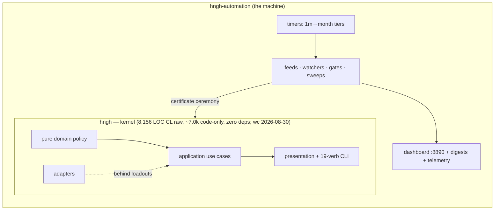

# 00 — Introduction: exploring the Hngh doc suite

Introduction v1.1, 2026-08-30 (revised after adversarial audit) · front door to the set indexed by
[README.md](README-architecture.md). Read this first; it routes you everywhere else.

## 1. What Hngh is, in three sentences

Hngh is trustworthy automation: development work happens in short, bounded,
evidence-leaving cycles while a human keeps the final say. The **kernel**
(`~/Projects/etc/hngh`, Common Lisp, zero dependencies) is side-effect-free —
it decides what is valid and refuses everything else; nothing changes the
system without a certificate bound to evidence. The **machine**
(`hngh-automation`, bash + Python on systemd timers) does the observing,
reviewing, researching, and plan-executing, landing its work as gated
commits — including, since 2026-08-24, every code-affecting kernel commit
through the certificate ceremony (docs/chore commits use the documented
manual `docs:` fallback).

Two ideas from roguelikes run the whole design: a **run** is finite
(permadeath — no silent retry; *evacuation* is the good ending, deliverables
handed over), and work happens in **camps** — one verified change, then a
recorded pause (`~/Projects/etc/hngh/docs/intent.md`).

## 2. The shape of the system

The machine depends on the kernel; the kernel depends on nothing. Full maps:
[03-kernel.md](03-kernel.md) and [04-automation-machine.md](../design/04-automation-machine.md).

## 3. The doc map

| # | Doc | Covers | Start here if… |
|---|---|---|---|
| 00 | this file | orientation + reading paths | you're new |
| 01 | [01-architecture-overview.md](01-architecture-overview.md) | one-file overview (8 sections, 3 diagrams) | you want the whole picture fast |
| 02 | [02-architecture-expanded.md](02-architecture-expanded.md) | v2 overview + the original R1-R7 investigation | you want the one-file deep version |
| 03 | [03-kernel.md](03-kernel.md) | kernel code: layers, lifecycle, 19 verbs, tests | touching kernel code or reviewing a ceremony |
| 04 | [04-automation-machine.md](../design/04-automation-machine.md) | cadence tiers, jobs, overnight cycle, gates | working on hngh-automation |
| 05 | [05-governance-loop.md](../design/05-governance-loop.md) | the certificate ceremony, closed vocabularies, landing rules | landing any kernel change; onboarding |
| 06 | [06-observability.md](../design/06-observability.md) | feeds, ledgers, alerts, watchers, the 08-30 fix set | debugging "why did the machine say that" |
| 07 | [07-roadmap-and-estimates.md](../project/07-roadmap-and-estimates.md) | stage route, pacing anchors, time estimates | planning the next wave |
| 08 | [08-refactor-investigation.md](../project/08-refactor-investigation.md) | R1-R7 refactor candidates, sequencing, operator-reserved decisions | deciding what to build next |
| 09 | [09-runbook.md](09-runbook.md) | health checks, stop commands, gates, daily reading | operating the machine right now |

## 4. Guided paths

- **Operator check-in (10 min)**: this file → [09-runbook.md](09-runbook.md)
  §5 (daily reading order) → `digest/MORNING-<date>.md` →
  `docs/project/reports.md` alert rows → [07](../project/07-roadmap-and-estimates.md)
  §4 (critical path).
- **Touching kernel code**: [03-kernel.md](03-kernel.md) →
  [05-governance-loop.md](../design/05-governance-loop.md) → repo docs in the read
  order of `~/Projects/etc/hngh/docs/README.md`.
- **Working on the machine**: [04-automation-machine.md](../design/04-automation-machine.md)
  → [06-observability.md](../design/06-observability.md) → [09-runbook.md](09-runbook.md).
- **Planning the next wave**: [07-roadmap-and-estimates.md](../project/07-roadmap-and-estimates.md)
  → [08-refactor-investigation.md](../project/08-refactor-investigation.md) →
  `docs/project/backlog.md`.

## 5. Names you will meet

**Run** — one bounded attempt with a lifecycle (created → armed → running →
checkpointed → evacuated/cancelled/dead → afterlife). **Camp** — one
verified change, then a recorded pause. **Ceremony / certificate** — the
evidence-bound approval that gates every kernel mutation. **Cadence tier** —
a systemd timer family (1m…month) running drop-in scripts. **Overnight
cycle** — executes accepted plans via delegated omp sessions. **Nerve
center** — the :8890 webapp. **STATE.md / reports.md** — the breadcrumb
trail and the alert ledger. **Research line** — a ~1h self-directed
expansion beat (planned → expanding → contracting → crystallized). Full
definitions live in the repo docs each doc cites.

## 6. Snapshot caveat

Everything here was read from this machine on 2026-08-30 and cites its
source file; the repos move daily (timers, sweeps, ceremonies). When this
set and the repos disagree, the repos win — start at
`~/Projects/etc/hngh/docs/README.md` (the repo's own read order) and
`hngh-automation/cadence/README.md`.
