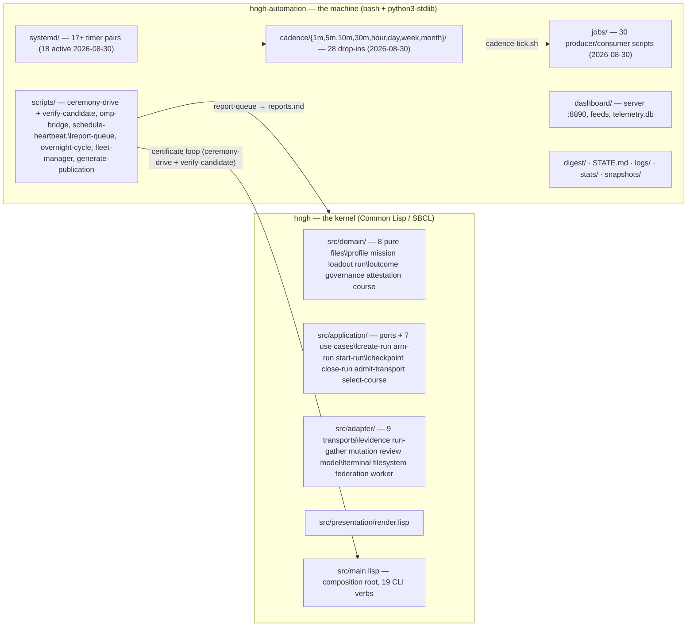

# Hngh — project architecture, scope, roadmap, and next-steps

<!-- MERGED 2026-10-13 from the 2026-08-30 doc suite, which lived
     outside version control (handoff §3.3). Provenance snapshot:
     paths and counts are as measured 2026-08-30. In particular
     `hngh-automation/` names a repo that has since merged into this
     one -- read it as `automation/`, and `~/Projects/etc/hngh` as the
     repo root. Facts that moved are fixed in place, not annotated. -->
Draft v1.2, 2026-08-30 (revised after adversarial audit). Written for the operator after 33h of unattended
operation (2026-08-28T19:43Z → 2026-08-30T04:54Z) proved the autonomy
machine end-to-end. Every claim carries a file or record reference.
The expanded companion (refactor/redesign investigation) is
`02-architecture-expanded.md` in this directory.

---

## 1. What Hngh is

Hngh turns development into short, bounded cycles — plan, check, record,
close — that an automated agent can run while a human keeps the final say
(`docs/intent.md` §What Hngh is). The kernel is side-effect-free: it owns no
background process, does nothing on its own, and refuses anything unknown or
unverified (fail-closed). Everything dynamic lives in a sibling "automation"
repo of plain scripts and systemd timers. The design borrows two ideas from
roguelike games, deliberately as metaphor: a **run** is finite (permadeath —
no auto-retry, no silent continuation; the good ending is *evacuation*, named
deliverables handed over), and work happens in **camps** — one behavior-sized
change, then a recorded pause for evidence and cleanup (`docs/intent.md`
§The roguelike idea).

The product is trustworthy automation: a paper trail for every action, and a
human with the final say. The kernel decides what is valid; the messy world
(files, git, models, terminals) is plugged in at the edges (`docs/project/roadmap.md`
Direction).

---

## 2. Repository map

Two local repos, one host:



### 2.1 The kernel repo (`~/Projects/etc/hngh`)

- **Language**: SBCL / Common Lisp. **Dependencies: zero external.**
  `hngh.asd` is `:serial t` over 28 files; every package is `(:use #:cl)`
  (`src/packages.lisp` — 15 packages: `hngh.domain`, `hngh`,
  `hngh.application`, 9 adapter packages, `hngh.presentation`, `hngh.main`,
  `hngh.tests`).
- **Layers** (dependency direction inward, Clean Architecture per
  `docs/core/clean-architecture-charter.md`):
  - `src/domain/` — pure policy: profile, mission, loadout, run (state
    machine `allowed-transition-p`), outcome, governance (principle matrix,
    evidence ledger, certificates, policy profiles), attestation (DSSE-style,
    pinned-key registry), course selection. No I/O anywhere.
  - `src/application/` — `ports.lisp` + 7 use cases: create-run, arm-run,
    start-run, checkpoint, close-run, admit-transport, select-course.
  - `src/adapter/` — 9 outward transports: evidence (git commands),
    run-gather, mutation (git add/commit executor), review (model), model
    (HTTP), terminal (operator I/O), filesystem (store), federation
    (attestation/keys/wake), worker (bounded read-only tasks).
  - `src/presentation/render.lisp` — factual renderer + reference lexicon
    (`docs/design/presentation-boundary.md`).
  - `src/main.lisp` — composition root, `dispatch-command` over 19 CLI verbs
    (`docs/project/roadmap.md` stage 0 row).
- **Size**: 8,156 LOC raw (`wc -l` over 28 `src/**.lisp`), 6,984 code-only
  (non-blank, non-comment) — as of 2026-08-30.
- **Tests**: `make test` = 2,855 checks in ~35-39s wall (kernel gate rows;
  `logs/drop-in-timing.log` 2026-08-29/30: 34.1-38.7s). Fixtures live in
  `tests/` (`domain/ application/ adapter/ presentation/ main/ fixtures/
  scripts/ support/ run.lisp`).
- **Scripts** (`scripts/`): `hngh` (the 19-verb CLI), `ceremony-drive`
  (closed governance loop driver), `report-queue` (append-only alert ledger),
  `omp-bridge` (omp delegation), `dashboard-readout` (JSON/TUI/HTML spine),
  `schedule-heartbeat`, `rotate-queue`, `worker-driver`, `fleet-manager`,
  `generate-publication`, `evolve-dashboard-style`, `grade-interface`,
  `evolve-operative`, `notify-agent`, `probe-model-route`.

### 2.2 The automation repo (`~/Projects/etc/hngh-automation`)

- **Stack**: bash + Python 3 stdlib + systemd user units. npm deps exist
  only for the UI audit (`axe-core`, `puppeteer-core` — `package.json`).
- **Cadence tiers** (`cadence/README.md`, 28 drop-ins total as of 2026-08-30):
  1m×2, 5m×4, 10m×1, 30m×6, hour×4, day×9, week×1, month×1.
  Each tier runs `jobs/cadence-tick.sh` → lexical order.
- **Key jobs** (`jobs/`): `oversight-tick.sh` (5m probes: loop recognition,
  tree-skew, stale stores; gated agentic steer leg), `agent-supervision.py`
  (transcript phase classification, stall flags, roguelike bridge-run
  replacement), `sessions-feed.py` (session observatory),
  `telemetry.py` + `telemetry-report.py` (SQLite WAL store + readers),
  `sweep-artifacts.sh` (hourly artifact commits), `dashboard-self-review.py`
  (hourly two-tier findings), `ui-audit.mjs` (axe + register rules),
  `lint-identifiers.sh` (gate; heredoc-aware since 08-29).
- **Scheduling**: 17+ systemd timer pairs in `systemd/` (18 hngh timers active
  as of 2026-08-30), installed by
  `make enable` (Makefile lines 10-25). Overnight cycle: `hngh-overnight.timer`
  2h cadence, executes *accepted plans* through bridge-gated delegated
  sessions (`scripts/overnight-cycle.sh`).
- **State surfaces**: `STATE.md` breadcrumbs (grows unboundedly; 4.1MB /
  37,915 lines as of 2026-08-30 — see R3),
  `digest/` (day/REVIEW/RESEARCH/MORNING/BENCH), `dashboard/*.json` feeds +
  `telemetry.db`, `logs/`, `stats/`, `bridge/` (live run records).
- **Dashboard**: `dashboard-server.py` on :8890, vanilla-JS views
  (`app.js` + per-tab `*-view.js`), winamp default theme, QoL graded by
  `grade-interface`; audit = `jobs/ui-audit.mjs` (axe-core + custom rules).
- **Dependency direction**: automation depends on kernel (reads its store,
  calls its CLI via `scripts/hngh`); the kernel depends on nothing.

---

## 3. The governance loop

The kernel's purpose, end to end. Everything a machine changes must pass:

```mermaid
sequenceDiagram
  participant A as Agent/session
  participant K as hngh kernel (CLI)
  participant E as Evidence adapter (git)
  participant P as Principle evaluator (deterministic)
  participant R as Review adapter (bounded model)
  participant C as Certificate
  participant M as Mutation executor
  A->>A: author change (docs/code/candidate)
  A->>A: run make test (gate)
  A->>A: ceremony-drive create-run (proposal class, evidence ledger)
  A->>E: gather-evidence (base rev, content hashes, source manifest)
  A->>A: deterministic principle evaluation (10/10 required)
  A->>R: request-review (bounded, source-cited; advises, never decides)
  A->>A: issue-certificate (candidate certificate binds paths+hash+verdicts)
  A->>M: mutation-check (git add/commit) — rechecks every fact at action time
  M->>M: commit lands (hash = certificate content hash)
  A->>A: push origin (green gate required)
```

Properties (from `docs/design/autonomous-development-control.md`):
deterministic evaluator — it never inspects the repo, network, or clock;
reviewers advise, never decide; a certificate authorizes exactly one action
and is re-verified at the moment of action; unknown/missing/stale anything
refuses (fail-closed). The dogfood loop (promotion rung 9) has landed every
code-affecting kernel commit since 2026-08-24 — 168 certificate-bound
commits as of 2026-08-30 (`git log --since=2026-08-24`: 208 commits, of
which 40 are plain docs/chore/merge — the documented manual `docs:`
fallback, e.g. tracked-report-body deletion `c0c0bd5`).

Landing rules observed in practice: hngh docs/records changes ride the
ceremony; kernel `src/`, `tests/`, `Makefile`, `hngh.asd` changes are
forbidden to unattended machine sessions (the autonomy rule in every plan
header) and park for the operator; hngh-automation changes are plain gated
commits.

---

## 4. The autonomy machine (what runs, when)

| Tier | Units | Work |
|---|---|---|
| 1m | `hngh-cadence-1m` | operator-items feed, sessions-feed (observatory) |
| 5m | `hngh-cadence-5m` | time-ledger, system feed, oversight tick (probes + gated steer), agent supervision |
| 10m | `hngh-cadence-10m` | evolve-ui (dashboard style evolution, graded) |
| 30m | `hngh-cadence-30m` | readout spine, system/schedule/research/plan feeds, config-backup |
| hour | `hngh-cadence-hour` | dashboard self-review, ui-audit, workbeat, session-cost |
| day | `hngh-cadence-day` 05:00 | ledger prune (48h), lesson harvest, activity tick, gate-check (both repos), review-prep (fresh-eyes), research-beat, remote posture, budget digest, doc-suite check |
| hour | `hngh-automation`/`hngh-autonomy` | heartbeat/queue rotation |
| day | others | security-check, credential-health, morning report (07:30), night-agent, night-research (23:40), model bench (01:10) |
| 2h | `hngh-overnight` | executes accepted plans via omp-bridge delegated sessions |
| week/month | Mon/1st 06:00 | roadmap review, zoom-out |

Sources: `cadence/README.md`, `systemd/*.{timer,service}`, live
`systemctl --user list-timers` (2026-08-30: all active, 0 failed).

Overnight cycle (`scripts/overnight-cycle.sh`, plan-gated): picks the next
accepted plan → per-step delegated omp sessions (`omp-bridge --run-start`
with budget loadout) → supervision watches (stall→replace for bridge runs)
→ landing: plain commits (automation) / certificate ceremony (kernel) →
parked steps file operator-facing alerts and the cycle moves on.

**Observed unattended behavior** (33h window, `docs/project/reports.md`
rows 218-337, automation commits 08-29): an 8-step plan executed end-to-end
overnight; 4 research lines crystallized (~1h each); ~40 sweep commits;
zero failed units; zero remote-model spend (GLM leg dormant, honest $0 row
`f5929eaa`).

```mermaid
timeline
  title One unattended day (evidence: reports.md + digest/2026-08-29.md)
  hourly : sweeps (sweep-artifacts) · dash self-review · ui-audit · workbeat
  30min  : config-backup · feeds (readout/system/schedule/research/plan) · config backup ok rows
  07:30  : morning report
  09:00  : morning digest
  2h     : overnight cycle — accepted-plan execution via bridge sessions
  on-red : oversight escalates gate-red rows; research beats fill any idle
```

---

## 5. Scope and boundaries

- **Kernel is side-effect-free.** No daemon, provider, watcher, scheduler;
  nothing writes to `~/.hngh`; every mutation requires a current,
  hash-bound certificate re-checked at the moment of action
  (`docs/design/autonomous-development-control.md` Explicit non-goals).
- **The retired system** (daemon + plugin era) is archived outside the repo;
  evidence only, no active gate (`docs/records/2026-08-19-archive-gate-retired.md`).
- **Forbidden to unattended sessions** (standing autonomy rule, in every plan):
  provider/credential configuration, systemd unit lifecycle beyond installed
  units, non-prune deletions, kernel `src/tests/Makefile/hngh.asd`, secrets.
  Critical-class work parks with operator-facing alerts and the cycle moves
  on — research beats are the filler, so the machine never idles on a human
  (`docs/records/2026-08-28-automation-advancement.md`).
- **Where things land**: cadence output → `digest/`; breadcrumbs → `STATE.md`;
  alerts/progress → `hngh:docs/project/reports.md` (+ `report-bodies/`);
  dashboard data → `dashboard/*.json` + `telemetry.db`; plan records → the
  plan file's own checkboxes; history → `docs/records/`.

---

## 6. Roadmap — the consolidated route (states as of 2026-08-30)

| Stage | Scope | State |
|---|---|---|
| 0 — Kernel & governance | pure spine, 6 use cases, C0-C3, 19 verbs, certificate loop | **done** |
| 1 — Self-watch | time ledger, dashboard self-review, oversight, watchdog, transcript supervision | **done** |
| 2 — One interface | nerve-center webapp (Schedule/Sessions/System/Research/Logs), deep-links, tiling, operator items | **landing** — tabs render both widths (08-27 witnessed), QoL specs landed 08-28 (`docs/design/logs-page-spec.md`, `research-page-spec.md`) |
| 3 — Roguelike delegation live | every delegated session wrapped; gantt actuals | **landing** — full cycle + seeded-stall replace witnessed 08-27 (`reports.md` rows 58-60); needs standing-gate stability |
| 4 — System harness D/E | config lanes, governed package ops, maintenance routines (CachyOS first) | queued |
| 5 — Research alternation institutionalized | research view drives alternation; telemetry register | queued (beats already run daily) |
| 6 — QoL & graphic evolution | widget grid, uPlot, Winamp themes, music-reactive | queued (evolve-ui already live) |
| 7 — Federation & fleet | multi-host lattice, wake, pooled resources | later |

Sequencing rule: grow cannot outrun its designs; research/design beats gate
the next grow stage when a grow run needs a missing design
(`docs/project/roadmap.md`).

---

## 7. Next-steps with time estimates

Pacing anchors (all measured this session):

| Anchor | Measured |
|---|---|
| Kernel gate (2,855 checks) | 35-39s (`drop-in-timing.log` 03-gate-check rows) |
| Kernel docs ceremony | ~4-10 min per landed commit (08-28 sessions) |
| Automation 8-step plan, unattended | one overnight, 13h18m wall (accepted 19:43:12Z → green 09:01:17Z) |
| One research line (unattended) | ~60-65min planned→crystallized (4 lines, 08-29) |
| Fresh-eyes review (local Qwen3.8-27B) | 339s wall (`REVIEW-2026-08-29.md` header) |
| Kernel code rung, operator+machine | ~2 rungs/day (rungs 10-18, 08-24→26) |

Estimates (machine pace = unattended cadence; operator sessions for kernel src):

| Work | Estimate | Basis |
|---|---|---|
| Stage 2 exit (deep-links, mobile widths, operator-item lifecycle proof) | 2-4 machine sessions + 1 operator session | tabs already render; cold deep-links + lifecycle witnessed once, need standing gates |
| Stage 3 exit (delegation live end-to-end + gantt actuals as default) | 1-2 machine sessions | both criteria witnessed 08-27; wiring to default paths |
| Stage 4 (config/package/maintenance, CachyOS) | 3-6 machine sessions + 2 operator sessions | new governed ops classes; certificate loop exists; package ops touch system state (normal-risk per-op certificates) |
| Stage 5 (alternation driver + research telemetry views) | 2-4 machine sessions | producers exist (telemetry.db, research feed); driver is view+wiring |
| Stage 6 | continuous, 1 graded QoL change/cycle | already running at 10m cadence |
| Stage 7 (second host) | 1-2 operator sessions + 2-4 machine | needs a second host + pinned keys (rungs exist) |
|omp-bridge refusal-cause sharpening (parked, kernel src)| 1 operator session (failing test + fix + ceremony) | backlog evidence |
| Remote GLM activation | operator action, 1 minute + 1 config check | token file placement (operator-critical class) |

## 8. Operating runbook pointers

- What runs where: `hngh-automation/digest/TRIP-STATUS-2026-08-28.md` (stop
  commands, log locations — still accurate).
- Alerts/progress: `hngh:docs/project/reports.md`; breadcrumbs: `STATE.md`.
- Daily artifacts: `digest/` (REVIEW / RESEARCH / MORNING / day narrative).
- Kernel gate: `cd ~/Projects/etc/hngh && make test` (2,855 checks).
- Automation gate: `cd ~/Projects/etc/hngh-automation && make test`;
  end-to-end proof: `make smoke`.
- Stop everything: the `systemctl --user stop ...` list in TRIP-STATUS.
- hngh-automation has **no git remote** (local-only by design); the kernel
  pushes to `git@github.com:boundring/hngh.git` after every green ceremony.
