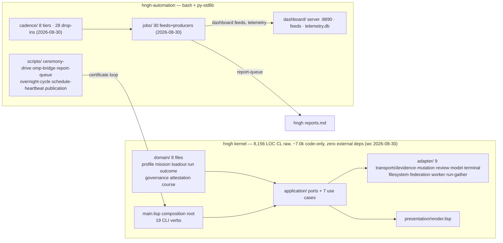
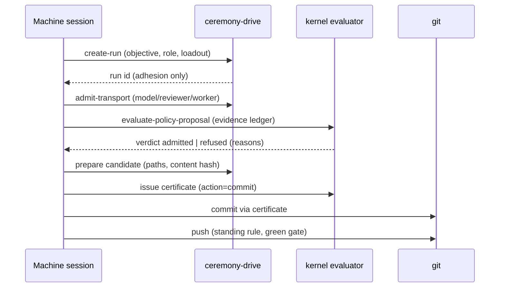

# Hngh — expanded architecture & refactor/redesign investigation

<!-- MERGED 2026-10-13 from the 2026-08-30 doc suite, which lived
     outside version control (handoff §3.3). Provenance snapshot:
     paths and counts are as measured 2026-08-30. In particular
     `hngh-automation/` names a repo that has since merged into this
     one -- read it as `automation/`, and `~/Projects/etc/hngh` as the
     repo root. Facts that moved are fixed in place, not annotated. -->
Expanded v2.1, 2026-08-30 (revised after adversarial audit). Supersedes (extends)
[01-architecture-overview.md](01-architecture-overview.md) in this
directory: same factual ground, plus a grounded refactor/redesign
investigation (R1-R7). Every candidate carries problem, evidence, options,
recommendation, effort estimate (anchors in §7), and a governance note.

---

## Part I — Architecture (as of 2026-08-30)

### 1. What Hngh is

Hngh turns development into short, bounded cycles — plan, check, record,
close — that an automated agent can run while a human keeps the final say.
The kernel is side-effect-free and fail-closed; the automation layer runs
plain scripts on systemd timers. Trustworthy automation needs a paper trail
and a human with the final say; every design decision keeps those two true
(`docs/intent.md`, `docs/project/roadmap.md` Direction). The roguelike
borrowing is discipline, not decoration: runs are finite, permadeath means no
silent retry, evacuation is the good ending, camps are one verified change
then a recorded pause (`docs/intent.md` §roguelike).

### Part 2 — Repository map

Two repos on this host:

Dependency facts (verified): `hngh.asd` — serial system, 28 files;
`src/packages.lisp` — every package `(:use #:cl)`, no external Quicklisp
deps; layers domain(8) → application(ports+7) → adapter(9) → presentation(1)
→ main. Tests: `make test` = 2,855 checks, 35-39s. Automation: bash +
Python-stdlib only; npm deps are audit-only (`axe-core`, `puppeteer-core`).
28 cadence drop-ins across 8 tiers (as of 2026-08-30); 30 jobs; 17+
systemd user timer pairs (18 active as of 2026-08-30); dashboard on :8890.

### Part 3 — The governance loop

Sequence: proposal (closed class) → deterministic principle evaluation over
the evidence ledger (every requirement kind closed; missing/duplicate/stale
facts refuse) → optional bounded model review (advises, never decides) →
candidate certificate (binds repository, base rev, paths, content hash,
verdicts, expiry) → mutation executor re-checks every fact at action time →
commit lands with the certificate content hash as its message → push after
green gates (`docs/design/autonomous-development-control.md`; every
code-affecting kernel commit lands certificate-bound as `hngh: candidate
<sha>` — 168 since 2026-08-24; the 40 plain docs/chore/merge commits in
that window use the documented manual `docs:` fallback). Refusal surfaces are
fail-closed; unknown categories refuse; a commit certificate never
authorizes a push.

### Part 4 — The autonomy machine

Tiers (systemd user timers, `cadence/README.md`):

| Tier | Drop-ins | Work |
|---|---|---|
| 1m | 2 | operator-items, sessions observatory |
| 5m | 4 | time-ledger, system, oversight (+loop recognition), agent supervision |
| 10m | 1 | evolve-ui (graded dashboard style evolution) |
| 30m | 6 | readout spine, system/schedule/research/plan feeds, config-backup |
| hour | 4 | dash self-review, ui-audit, workbeat, session-cost |
| day 05:00 | 9 | ledger prune, activity tick, lesson harvest, gate-check (both repos), review-prep, research-beat, remote posture, budget digest, doc-suite check |
| week/month | 2 | roadmap review, zoom-out |
| 2h | — | overnight cycle: executes accepted plans via omp-bridge sessions |
| misc | — | security (4h), credential-health, night-agent, night-research (23:40), model bench (01:10), morning (06:00), morning report (07:30), autonomy (hour) |

Proven unattended (33h window ending 2026-08-30T04:54Z): one 8-step plan
executed to green (both gates), 4 research lines crystallized, ~40 sweep
commits, 0 failed units, 0 kernel commits after plans ran dry. Landing
semantics: automation = plain gated commits; kernel = certificate ceremony.

### Part 5 — Scope & boundaries

Kernel: side-effect-free, no daemon, refuses unknown input; system mutation
only through certificate-bound executors with named rollback. Machine
sessions may never: touch provider/credential config, alter systemd units
beyond installed ones, make non-prune deletions, or edit kernel
src/tests/Makefile/hngh.asd. Research lines are the sanctioned filler when
plans run dry. The retired daemon/plugin system is external archive only
(`docs/records/2026-08-19-archive-gate-retired.md`).

### Part 6 — Roadmap states

Stage 0/1 done. Stages 2 and 3 landing (criteria witnessed 08-27; standing
gates pending). 4-6 queued, 7 later — details and exit criteria in
`docs/project/roadmap.md` route table; unchanged here.

### Part 7 — Next-steps with estimates

Measured anchors: kernel gate 35-39s; docs ceremony 4-10min; 8-step plan ≈
13h18m unattended; research line ≈ 1h; fresh-eyes review 339s; kernel rungs ≈
2/day with operator. Estimates: stage 2 exit 2-4 machine sessions + 1
operator; stage 3 exit 1-2; stage 4 3-6+2; stage 5 2-4; stage 7 1-2 operator
+2-4 machine; omp-bridge refusal sharpening 1 operator session; GLM leg
activation 1 operator minute. (Unchanged from the draft; see §7 there for
the anchor table.)

### Part 8 — Runbook pointers

See draft §8 (unchanged): TRIP-STATUS for stop commands; reports.md for
alerts; STATE.md breadcrumbs; `make test`/`make smoke` gates; automation
repo is local-only (no remote), kernel pushes to boundring/hngh.

---

## Part 9 — Refactor & redesign investigation

Each candidate: problem → evidence → options → recommendation → estimate →
governance note.

### R1. Report-ledger strain (`reports.md` as git ledger)

- **Problem.** Machine rows land ~1/30min plus alerts: 359 table rows /
  67,426B as of 2026-08-30 (grows unboundedly), append-only in the kernel
  repo; each day-tier sweep drags the
  whole ledger through git. The 48h prune deletes bodies but rows are
  forever. Meanwhile `telemetry.db` (SQLite WAL, `jobs/telemetry.py`) already
  captures structured events with zero readers-turned-consumers as of 08-29.
- **Evidence**: `docs/project/reports.md` grows unboundedly — 359 rows /
  67,426B as of 2026-08-30; row-per-30m
  config-backup + course cards dominate; telemetry.db 40,960B (as of
  2026-08-30) with 36+ ui-audit
  events captured 08-28; retention spec
  `docs/design/ledger-and-records-spec.md` §2 (raw 7d / rollups 90d /
  curated permanent).
- **Options**: (a) status quo — git ledger grows forever; (b) split the
  stream: machine-generated progress rows → telemetry.db (+ daily digest
  rows in git), alerts stay in reports.md; (c) full telemetry migration.
- **Recommendation**: (b). Alerts are operator-facing and small (git
  deserves them); progress/spam rows are the bulk (config-backup alone is
  ~100 rows/2 days) and are machine-consumed — the db is their home. Git
  keeps narrative records + alerts.
- **Estimate**: 1 machine session (producer switch in report-queue callers
  behind a flag + one ceremony to update the ledger spec) + 1 operator
  session for the spec edit.
- **Governance**: kernel docs change = ceremony; routing change =
  normal-risk automation.

### R2. Plan-authoring gap (the 33h idle)

- **Problem**: the machine executed an 8-step plan flawlessly, then sat
  kernel-idle 33h — plans are operator-authored and the machine cannot
  author one. Execution is solved; authorship is the frontier (report
  lesson d).
- **Evidence**: zero hngh commits after `667a36b`; heartbeat "next
  wake-mutation-lane" stale; budget digest honest $0.
- **Options**: (a) night-agent authors normal-risk plan drafts each night
  from the Next-necessary list/backlog, operator accepts in the morning
  digest; (b) operator authors on cadence; (c) operator-item → plan
  routing (see R6).
- **Recommendation**: (a), keeping operator acceptance explicit and
  critical-class parked (unchanged rule). The pieces exist: night-agent
  session, plans/README gate-driven normal-risk acceptance, backlog rows
  with problem/outcome/verification shaped exactly like plan steps.
- **Estimate**: 1 operator session to write the authoring prompt + 1
  machine session to wire "author draft → park for acceptance" into
  night-agent.
- **Governance**: policy change (who may author) = operator decision;
  mechanism itself is normal-risk.

### R3. STATE.md unbounded growth

- **Problem**: 4.1MB / 37,915 breadcrumb lines as of 2026-08-30 (grows
  unboundedly), minute-tier ticks appending
  thousands of rows/day (REVIEW-2026-08-28 flag; retention tiers already
  specified in `ledger-and-records-spec.md` §2 — raw 7d, rollups 90d,
  curated permanent).
- **Options**: (a) producer-side rotation (date-partitioned STATE files,
  prune >7d raw like the alert ledger); (b) telemetry-store succession
  (breadcrumbs into `events` table; STATE.md keeps tail + rotation);
  (c) status quo.
- **Recommendation**: (a) now (small diff in `lib/breadcrumbs.sh`: daily
  file, prune past 7d — mirrors 02-ledger-prune), (b) when R1 lands (same
  store, one writer).
- **Estimate**: (a) 1 machine session; (b) rides R1.
- **Governance**: normal-risk; prune-style deletion inside the existing
  48h/7d retention rules.

### R4. Bash drop-in sprawl

- **Problem**: 28 drop-ins across 8 tiers (as of 2026-08-30) repeat the same
  timeout/lock/breadcrumb/skip-if-missing scaffolding; each new drop-in
  re-copies it (source of the 08-28 trailing-`\` bug class).
- **Options**: (a) shared job-runner contract in `lib/` (one `run_dropin`
  wrapper: flock, timeout -k, breadcrumb, fail-closed; drop-ins shrink to
  their payload); (b) status quo; (c) rewrite in Python (rejected: churn
  without behavior gain).
- **Recommendation**: (a) only as *absorption*: new drop-ins use the
  wrapper; existing ones convert opportunistically when touched. A
  big-bang rewrite of 28 working scripts fails the deletes-more-than-it-
  adds test.
- **Estimate**: 0.5 machine session for the wrapper; per-script savings
  later.
- **Governance**: normal-risk automation.

### R5. Presentation split (kernel vs webapp)

- **Problem**: kernel `src/presentation/render.lisp` is one file serving
  operator text; the webapp renders its own JSON. Two presentation layers
  could drift (the reports.md double-header class of bug, but for surfaces).
- **Options**: (a) status quo — webapp consumes kernel output as data
  (dashboard-readout reads the repos; kernel renders CLI text);
  (b) shared presentation contract (kernel emits the spine JSON the webapp
  consumes).
- **Recommendation**: (b) *narrowly*: the spine (`dashboard-readout --json`)
  is already that contract — formalize it (document the schema in
  `docs/design/`, one producer, atomic writes per today's F2 fix) rather
  than grow a second renderer inside the kernel. Keeps dependency direction:
  webapp stays outward of the kernel; kernel never imports webapp.
- **Estimate**: 1 machine session (schema doc + producer consolidation).
- **Governance**: normal-risk; no kernel code change.

### R6. Self-observation closure (alert → plan-candidate routing)

- **Problem**: the machine alerted "readout.json unparsable" 27+ times over
  two days and never routed a fix; verification without repair is half a
  nervous system (report lesson a).
- **Evidence**: alerts `e5f68caa` (×24), `f438818b`; the F2 fix needed a
  human director to route.
- **Options**: (a) operator-item → next-plan-step: recurring alert
  identities (≥3 in window, stable identity) become draft plan steps
  queued for operator acceptance (rides R2's mechanism); (b) allow the
  steer leg to attempt producer fixes directly (rejected: script repair is
  a write path the steer leg must not have).
- **Recommendation**: (a), gated by R2's acceptance flow and the
  escalation caps from the backlog row.
- **Estimate**: 1 machine session after R2.
- **Governance**: normal-risk; operator acceptance still required per plan.

### R7. ui-audit → fix loop (a11y)

- **Problem**: name-completeness flake fixed today by re-read (F5), but
  genuine a11y regressions (18-violation class, 08-29 12:00Z) still only
  alert. The ui-audit→oversight feed (plan step 8) now raises regression
  breadcrumbs; no repair path exists.
- **Options**: (a) fold "fix flagged rule if mechanical (aria-labels,
  titles)" into the next authored plan automatically (rides R2/R6);
  (b) leave manual.
- **Recommendation**: (a) once R2 exists — the alert already carries the
  rule identity and example selectors.
- **Estimate**: folded into R2/R6 (0.5 session).
- **Governance**: normal-risk.

### Sequencing (recommended)

| When | Work | Hours (est.) |
|---|---|---|
| Next session (operator) | GLM token placement decision; accept R2 policy; author/accept next kernel-src session (omp-bridge refusal cause) | 1 + existing session |
| Next machine sessions (this week) | R3(a) STATE rotation; R5 spine-contract doc; stage-3 standing-gate wiring | 2-3 machine sessions |
| Next week | R1 ledger split behind flag; R2 night-agent authoring prompt; stage-2/3 exit proofs | 3-4 machine + 1 operator session |
| Next month | Stage 4 rungs (config/package governed ops); R6 closure; stage-5 alternation driver | 5-8 machine + 2-3 operator |

### Policy decisions reserved to the operator

1. GLM remote leg activation (token placement) — credential class.
2. Who may author plans (R2) — even with normal-risk acceptance automated,
   authorship authority is a policy grant.
3. Ledger stream split (R1) — changes what git permanently records;
   retention policy is operator-owned per the ledger spec.
4. Any kernel src/Makefile/ASD change — standing autonomy rule forbids
   machine sessions; stays operator-directed (omp-bridge refusal cause,
   supervision kernel-side sharpenings).
5. Adding a git remote to hngh-automation (currently local-only by design).

## Verification of this document

Every file referenced above was read this session (kernel src layout,
packages, hngh.asd, Makefile, cadence README, oversight/sweep/supervision
sources, reports.md, digests, plan file, TRIP-STATUS, pacing logs). Counts
(as of 2026-08-30): kernel src 8,156 LOC raw / 6,984 code-only (wc), 28 src
files (glob), 2,855 kernel checks (gate rows), 28 cadence drop-ins, 30 jobs,
STATE.md 4.1MB/37,915 lines (grows unboundedly), reports.md 359 rows (grows
unboundedly).
