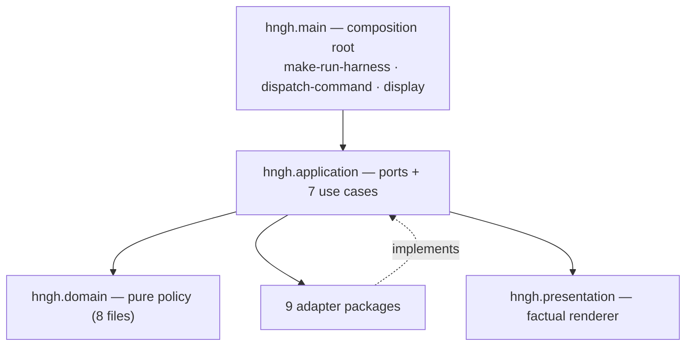
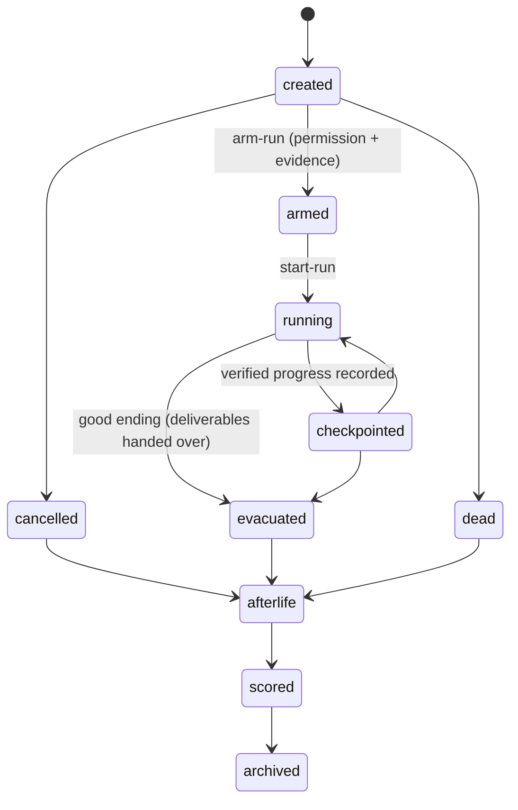

# 03 — The kernel (`hngh`): code and structure

Doc suite v1.2, 2026-08-30 (revised after adversarial audit) · companion to `README.md` in this directory.
Claims carry file references; all read this session.

## 1. Identity

A compact local control kernel: Common Lisp on SBCL, zero external
dependencies. `hngh.asd` is one serial system over 28 files
(the repo root); every package is `(:use #:cl)`
(`src/packages.lisp`). 8,156 LOC raw across `src/` (`wc -l` over 28
`src/**.lisp`; 6,984 code-only non-blank non-comment) — as of 2026-08-30. The
kernel is side-effect-free: no persistence, clock, environment lookup,
subprocess, port, service, or background process in the domain
(`docs/core/run-contract.md` §hngh.domain defines pure run policy). It does
nothing on its own and refuses anything unknown or unverified.

## 2. Layers (dependency direction inward)

Dependency law: application depends on domain only; adapters implement
application ports; presentation renders application output and imports no
adapter; `hngh.main` composes all of it (`docs/core/component-map.md`
dependency rules; `docs/core/clean-architecture-charter.md` dependency law).
A package export is public only when a test uses it through its named
boundary — exports without tests are not public.

### Layer inventory (verified via `glob src/**` + `hngh.asd`)

| Layer | Files | Role |
|---|---|---|
| `src/domain/` | profile, mission, loadout, run, outcome, governance, attestation, course | pure policy + immutable values; closed vocabularies; transition policy |
| `src/application/` | ports + create-run, arm-run, start-run, checkpoint, close-run, admit-transport, select-course | use cases over injected ports |
| `src/adapter/` | evidence, run-gather, mutation, review, model, terminal, filesystem, federation, worker | outward transports, manually composed |
| `src/presentation/` | render.lisp | factual renderer + optional reference lexicon; renders refusals literally |
| `src/main.lisp` | composition root | `make-run-harness` + `dispatch-command` (19 verbs) |

Adapter admission rule (component map): a transport exists only behind a
run loadout carrying its route/labels — `:model-review` behind a
non-`local` route + `model-review` label; `:terminal` behind the
`terminal-input` label; `:federation` behind `remote-evidence`/
`carrier-bundle`. **No default provider or input source exists** — no
transport is active by import or plain `scripts/hngh` invocation.

## 3. The run lifecycle (pure state machine)

`src/domain/run.lisp`, `allowed-transition-p`; every unlisted pair signals
`invalid-run-transition`; `advance-run` returns a new run, input unchanged
(`docs/core/run-contract.md`):

| From | Legal targets |
|---|---|
| `created` | `armed`, `cancelled`, `dead` |
| `armed` | `running`, `cancelled`, `dead` |
| `running` | `checkpointed`, `cancelled`, `evacuated`, `dead` |
| `checkpointed` | `running`, `cancelled`, `evacuated`, `dead` |
| `cancelled`/`evacuated`/`dead` | `afterlife` |
| `afterlife` | `scored` → `archived` → none |

Value contracts (`docs/core/run-contract.md`): Mission carries objective,
non-objectives, source references, acceptance criteria, writable scopes,
verification, evacuation condition; Loadout carries route label + context/
token/cost/time limits + tool/network labels + writable scopes; Receipt,
Score, and Afterlife records hold evidence only — they never grant
authority. Constructors are closed-field, defensive-copying, read-only-slot.
Evidence is non-authoritative by design: no record can flip a state or
start a run.

## 4. The 19-verb operator surface

`scripts/hngh` (SBCL wrapper) → `hngh.main:dispatch-command`, closed set
(`README.md` lines 94-98):

`create-run`, `admit-transport`, `arm-run`, `start-run`, `checkpoint`,
`close-run`, `present`, `review`, `terminal`, `propose`, `issue-cert`,
`mutation-check`, `fetch-evidence`, `verify-attestation`, `list-pins`,
`wake-peer`, `run-worker`, `select-course`, `status`.

Strict exit codes: 0 accepted · 1 refused/conflict · 2 malformed · 3
transport fault. Persistence only under explicit `--store=PATH` — no
implicit state anywhere.

## 4.1 The components table (public boundaries)

Twelve components, each with reason-to-change, public API, allowed
dependencies, deployment form, and owner/reviewer role
(`docs/core/component-map.md`). Highlights:

- `hngh.adapters.evidence` — `gather-evidence` over a **fixed** command set
  (`:repository-revision`, `:working-tree-status`, `:file-sha256`);
  unknown commands, malformed output, escaping targets, duplicates fail
  closed.
- `hngh.adapters.mutation` — `execute-mutation` rechecks every certificate
  fact against fresh evidence, then emits only the certificate-bound fixed
  Git action.
- `hngh.adapters.review` — `request-review` over a closed request contract;
  output mapped to sanitized findings + one review evidence fact. Reviewers
  advise, never decide.
- `hngh.adapters.model` / `hngh.adapters.terminal` — manually composed,
  admitted only behind a matching run loadout; **no default transport exists
  by import or in plain CLI invocations**.
- `hngh.presentation` — plain factual strings, refusals kept literal,
  optional reference lexicon as display copy only; imports no adapter
  (`docs/design/presentation-boundary.md`).

## 5. Tests and gate

`make test` = 2,855 checks in 35-39s wall (gate rows
`hngh-automation/logs/drop-in-timing.log`: 34.1-38.7s across 08-29/30). The
count grows with every closed vocabulary. Fixtures under `tests/` (domain /
application / adapter / presentation / main / fixtures / scripts / support /
run.lisp).
Every public export is test-exercised through its component boundary; a
package export without a boundary test is not public (component map rule).

## 6. Scripts (operator surface)

`scripts/`: `hngh` (19-verb CLI; strict exit codes 0/1/2/3; persistence only
under `--store=PATH`), `ceremony-drive` (closed governance loop driver:
create-run → admit → verdict → prepare-candidate → commit), `report-queue`
(append-only alert ledger in the kernel repo), `omp-bridge` (omp delegation
with budget loadouts), `dashboard-readout` (JSON spine / TUI / export HTML),
`schedule-heartbeat` (single-tick scheduler), `rotate-queue`,
`worker-driver` (one-shot worker cycle), `fleet-manager` (discovery + pinned
WOL), `generate-publication` (daily journal / ebook / site),
`evolve-dashboard-style`, `grade-interface`, `evolve-operative`,
`probe-model-route`, `verify-candidate.py`.

## 7. Tests directory layout

`tests/` mirrors the layers: `domain/ application/ adapter/ presentation/
main/ run.lisp fixtures/ scripts/ support/` — property tests for the
governance matrix (`docs/records/2026-08-24-governance-property-tests.md`),
hermetic selfchecks in automation jobs mirror the same discipline
(`agent-supervision.py --selfcheck`).

Cross-links: [05-governance-loop.md](../design/05-governance-loop.md) ·
[07-roadmap-and-estimates.md](../project/07-roadmap-and-estimates.md) ·
`docs/core/clean-architecture-charter.md` (dependency law) ·
`docs/core/test-boundary.md` (fixture rules).
