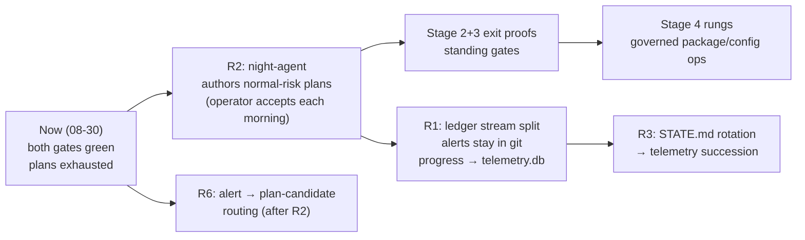

# 07 — Roadmap and estimates

Doc suite v1.2, 2026-08-30 (revised after adversarial audit) · part of [README.md](../core/README-architecture.md). The route table
summarizes `docs/project/roadmap.md` (authoritative for exit criteria);
estimates derive from measured pacing anchors only.

## 1. The consolidated route

Seven stages; a stage is done when its **exit criteria hold under the
standing gates**, not when code exists. Stages 5 and 6 alternate with grow
beats (master-plan §4): grow cannot outrun its designs.

| Stage | Scope | Exit criteria (abridged) | State 2026-08-30 |
|---|---|---|---|
| 0 — Kernel & governance | pure spine, 6 use cases, C0-C3, 19 verbs, certificate loop | `make test` green; every commit certificate-bound; loop-history guard silent | **done** |
| 1 — Self-watch | time ledger at every level; dashboard self-review; oversight alerts; watchdog; transcript supervision | self-review silent when healthy, catches a seeded fault in one tick | **done** |
| 2 — One interface | nerve-center webapp: formal tabs, deep-links, tiling+spawn, operator-item lifecycle | every tab renders desktop+mobile; cold deep-links mount; operator items flow open→handled→dismissed | **landing** — tabs render both widths (witnessed 08-27); QoL specs landed (`docs/design/logs-page-spec.md`, `research-page-spec.md`); cold deep-link + lifecycle witnessed once |
| 3 — Roguelike delegation live | every delegated session wrapped run-start→observatory→run-end; self-supervision; gantt actuals | one full cycle witnessed live; seeded stall flagged+replaced without human | **landing** — both criteria witnessed 08-27 (`reports.md` rows 58-60: wrap + seeded-stall replace in one tick); needs standing-gate stability |
| 4 — System harness D/E | config lanes, governed package upgrades, maintenance routines (CachyOS first) | a governed package upgrade runs start-to-finish through the certificate loop on this host | queued |
| 5 — Research alternation | research view drives alternation; telemetry register; tech-tree presentation | a research beat lands a parseable artifact through standard gates without a human demanding it | queued (beats already run daily on cadence) |
| 6 — QoL & graphic evolution | widget grid, uPlot, Winamp themes, music-reactive | one graded, revertible QoL change per cycle with before/after evidence | queued (evolve-ui already live at 10m) |
| 7 — Federation & fleet | multi-host lattice, wake, pooled resources | a second host orients, admits, backs up through the same gates | later |

Sequencing rules: every stage feeds stage 1's ledger; nothing skips the
gates; grow cannot outrun its designs — research/design beats gate the next
grow stage when a grow run needs a missing design.

## 2. Measured pacing anchors (all observed, not estimated)

| Anchor | Measured | Source |
|---|---|---|
| Kernel gate (2,855 checks) | 35-39s | `logs/drop-in-timing.log` 03-gate-check 08-29/30 |
| Kernel docs ceremony landing | 4-10 min per commit | 08-28 ceremony sessions |
| 8-step automation plan, unattended | 13h18m wall (accepted 19:43:12Z → gates green 09:01:17Z) | plan `667a36b` + rows `f92dc864` |
| One research line (planned→crystallized) | 60-65 min | 4 lines on 08-29 (`reports.md` rows 220-255) |
| Fresh-eyes review (local Qwen3.8-27B) | 339 s | `digest/REVIEW-2026-08-29.md` header |
| Kernel code rungs | ~2/day (operator + machine, rungs 10-18) | 08-24→26 records |
| Overnight session budget | 1,800s cap per delegated run (rc=124 lesson) | `scripts/overnight-cycle.sh` `TIMEOUT_S` default 1800 + `docs/records/2026-08-28-lessons-consolidation.md` §4 (rc=124 rows 03:29Z/05:00Z/07:00Z, `agent-handoffs.md`) |

## 3. Per-stage estimates

| Work | Estimate | Basis |
|---|---|---|
| Stage 2 exit (deep-links + mobile widths + operator-item lifecycle as standing gates) | 2-4 machine sessions + 1 operator session | criteria witnessed once each; standing-gate wiring + proof runs |
| Stage 3 exit (delegation live as default path) | 1-2 machine sessions | both criteria witnessed 08-27; remaining work is defaulting + stability |
| Stage 4 (config lanes, governed package ops, maintenance) | 3-6 machine sessions + 2 operator | new governed op classes; certificate machinery exists; per-op normal-risk certificates |
| Stage 5 (alternation driver + telemetry views) | 2-4 machine sessions | producers exist (telemetry.db, research feed); driver is view + wiring |
| Stage 6 | continuous, 1 graded QoL change/cycle | already running at 10m cadence |
| Stage 7 (second host) | 1-2 operator + 2-4 machine | needs second host + pinned keys; rungs exist |
| omp-bridge refusal-cause (kernel src) | 1 operator session (failing test → fix → ceremony) | parked by autonomy rule |
| GLM remote leg activation | 1 operator minute + config check | token file placement (credential class) |

Assumption: unattended machine pace for automation work; operator sessions
for anything touching kernel `src/` or credentials. Plans run dry without
an author (33h kernel idle after the evening plan executed) — closing that
gap is R2.

## 4. The near-term critical path

Cross-links: [08-refactor-investigation.md](08-refactor-investigation.md)
· `docs/project/roadmap.md` (route table + exit criteria) ·
`docs/project/plans/README.md` (gate-driven normal-risk acceptance rule).
